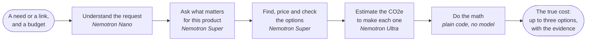
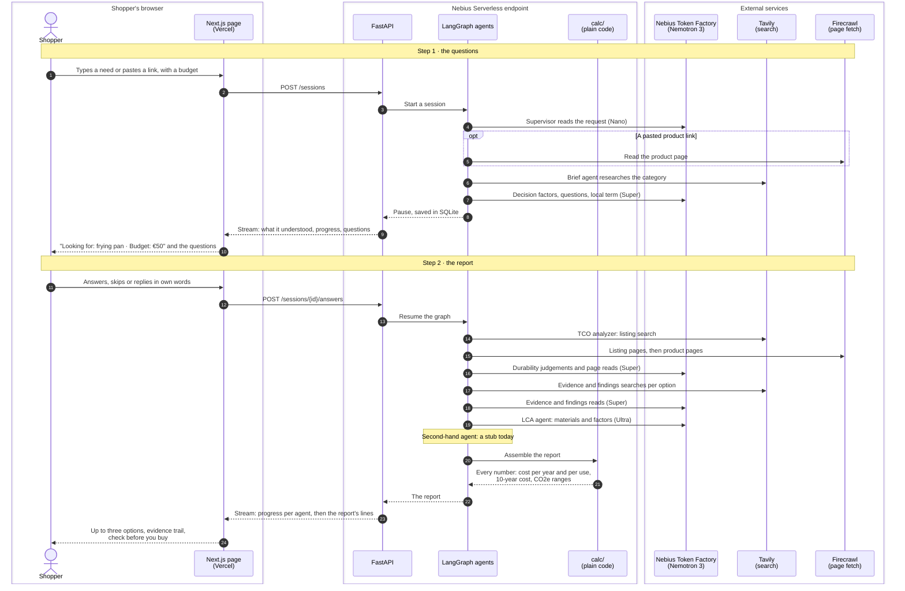

# True Cost Copilot

Cheap products often cost more over time, but shoppers only see the sticker price. True Cost
Copilot takes a product link or a need ("I need a new frying pan, budget €50"), asks what matters
for that product, and returns the options worth buying with their cost per year, cost per use,
expected lifespan and the evidence behind it, a 10-year comparison against cheap replacements,
and an estimate of the CO2e to make each one. Netherlands first, EU overall, prices in EUR. The
page is called **unboxed.**

Hackathon project for Nebius x NVIDIA, "Best Apps and Agents" track. Open source under the
[MIT licence](LICENSE).

- [Try it](#try-it)
- [The problem](#the-problem)
- [How it works](#how-it-works)
- [Nemotron models and Nebius](#nemotron-models-and-nebius)
- [Run it locally](#run-it-locally)
- [Limitations](#limitations)
- [Where this is heading: Digital Product Passports](#where-this-is-heading-digital-product-passports)
- [Licence](#licence)

## Try it

**<https://truecost-unboxed.vercel.app>**, no login needed. Best viewed in a desktop browser:
the layout works on a phone, but the phone view is still being polished.

**Planned availability:** from Monday 30 November 2026 until Wednesday 23 December 2026, 12:00 PT
(21:00 CET). It is also up on Friday 30 October 2026 until 21:00 CET. Outside these times the
backend is stopped to save credits: the page still opens, but a request gets no answer. To run it
yourself at any time, see [Run it locally](#run-it-locally).

A first analysis of a product takes up to about four minutes, and less for one already researched.
Up to 10 sessions an hour can start from one connection and 46 a day from everyone together; after
that the page says when to try again. What you type is logged to improve the app, as the page says.

## The problem

Take a made-up but typical case: a €20 non-stick pan that lasts two years costs €10 a year; a €45
stainless pan that lasts ten costs €4.50 a year. Over ten years the cheap one is bought five times, and each of those pans had to be
made. Shoppers see the sticker price, not this, and the product pages that might tell them are
full of unsourced claims.

The app works out the real cost of a purchase and a better option that still fits the budget. It
is wallet first: the budget is a hard limit, and the lower CO2e of buying one durable item instead
of several cheap ones is the bonus of the better-value choice, stated as a sourced, labelled
figure, never as a lecture.

## How it works

1. **You type a need or paste a product link**, with a budget if you have one. The app shows what
   it understood ("Looking for: frying pan · Budget: €50") so a mistake is caught before anything
   is searched.
2. **It asks first.** Up to five questions about what matters for this kind of product, each with
   a one-line reason and its source, researched fresh for the category: what buyers usually find
   out too late, and how often you will use it. Every question can be skipped or answered in your
   own words.
3. **The agents research the options** on Dutch comparison sites, read each candidate's own product
   page for its price and what it sells, look up durability evidence and what testers and owners
   report, and estimate the CO2e of making each option.
4. **The report** shows up to three options side by side: price, cost per year, cost per use,
   lifespan with what it rests on, the 10-year cost and how much it saves against the cheapest,
   CO2e with its confidence label (and, beside how much less it takes to make, a distance driven
   in an average new car for scale), your answers checked against each option, and a
   "check before you buy" list of what is still unknown. One line at the top counts how much of
   it rests on sources.
5. **The evidence trail** says, step by step, what each agent found, decided and left out, and why.

Every number shown is computed in code (`src/shopper/calc/`), never written by a model. Models
read pages and judge; code checks every quote they cite against the page and does the arithmetic.

### At a glance



Each step runs as an agent in one LangGraph graph; the models run on Nebius Token Factory. The
diagrams below drill down.

### The system

One session, lane by lane: who does what, and which service each step calls. The graph pauses
between the two steps and is saved, so the questions can be answered at any time within 7 days.



A request that is not a durable product (food, a service, a car) leaves straight after the
supervisor with a friendly decline. The graph, as `build_graph` wires it, is drawn in
`docs/architecture/graph_diagram.md`; the system map is `docs/service_architecture.md`.

### Inside each agent

One diagram per agent that runs today (supervisor, brief agent, TCO analyzer, LCA agent) is in
[`docs/architecture/agent_diagrams.md`](docs/architecture/agent_diagrams.md), the TCO analyzer's
search for product options among them.

### When the report says "could not be confirmed"

The report would rather say it does not know than let a model guess. Every lifespan, factor value
("works on induction", "stainless interior") and finding must be backed by a quote that code finds
on the cited page, in a passage that names the product. A value with no such quote is shown as
"not confirmed on the pages read" and goes on the check-before-you-buy list; a lifespan with no
evidence is marked "rough estimate" and rests on the material judgement alone. The evidence search
per option (`"{product} durability lifespan warranty"`) is aimed at lifespans, so it seldom
returns a page that states a kettle's interior material or a pan's hob compatibility, and many
factor values come back unconfirmed.

## Nemotron models and Nebius

All model calls go to **Nebius Token Factory**, through its OpenAI-compatible API with one key.
Three NVIDIA Nemotron 3 models do different jobs; a component asks for a tier, never a model name,
and the IDs live only in `src/shopper/config.py`.

| Tier | Model | What it does |
|---|---|---|
| small | Nemotron 3 Nano (`nvidia/NVIDIA-Nemotron-3-Nano-30B-A3B`) | Reads the request: scope, category, budget, and the product name at a pasted link |
| medium | Nemotron 3 Super (`nvidia/nemotron-3-super-120b-a12b`) | Researches the category and phrases the questions, reads your reply, finds the local category term, judges each candidate's durability, reads what each product page sells, reads the durability evidence and what testers and owners report |
| large | Nemotron 3 Ultra (`nvidia/Nemotron-3-Ultra-550b-a55b`) | Estimates the materials, masses and emission factors of every option in one call when nothing published exists (LCA tier 3); code multiplies them out |

The large model runs once per report and nowhere else. The terminal app's evidence trail and the
LangSmith traces record which tier made each judgement; the page names no model. Details: `docs/architecture/models.md`.

**Where Token Factory helped.**

- **Three sizes behind one API and one key.** Matching each job to the smallest model that does it
  well kept a whole analysis cheap: across 29 traced runs, the median cost of the research after
  the questions was $0.057 ($0.043 to $0.084), and a start up to $0.026 more
  (`docs/findings/task_3.5.md`). That is what made a free public demo affordable.
- **Structured output on every model.** `response_format` with a JSON schema generated from the
  pydantic models validated on the first try in every call measured (`docs/findings/task_1.2.md`),
  so each agent returns typed data that code can check, not free text to parse.
- **Control over reasoning.** Super's `low_effort` mode, passed through `chat_template_kwargs`,
  is honoured: the brief agent's read went from 13 to 39 s to 2.4 to 7.4 s, which brought the
  questions within 30 s of pressing Enter for a category not seen before
  (`docs/findings/task_1.7.2.md`). Calls where quality dropped with little reasoning (the
  durability judgements, the evidence read) reason in full.
- **OpenAI compatibility.** One small client (`src/shopper/llm.py`), and LangSmith traces with the
  tokens and cost of every call, with no adapter.

**Nebius AI Cloud** hosts the backend: the FastAPI app runs as a **Nebius Serverless endpoint**
(`cpu-d3`, 2 vCPU and 8 GB, region `eu-west2`) from an image GitHub Actions builds, with the
service keys in a Nebius secret (`nebius mysterybox`), never in the image. The frontend is on Vercel. How it is
deployed: `docs/building_the_project.md` ("Deployment").

**Model availability.** Nebius retires two of the three models from Token Factory Serverless on
9 November 2026, with no automatic rerouting
([Model Deprecations: November 2026](https://docs.tokenfactory.nebius.com/model-deprecations-november-2026)):
the small tier `nvidia/NVIDIA-Nemotron-3-Nano-30B-A3B` and the medium tier
`nvidia/nemotron-3-super-120b-a12b`. The large tier stays. The IDs can be overridden with
`NEBIUS_MODEL_SMALL`, `NEBIUS_MODEL_MEDIUM` and `NEBIUS_MODEL_LARGE`; from 9 November the demo runs
on Nebius's recommended replacements, `nvidia/Nemotron-3_5-Lightning` and
`nvidia/Nemotron-3.5-Super-VL`, with no change to the code beyond the model IDs; the app has not
yet been tested on them (`docs/architecture/models.md`, "Tiers"). The submission and its findings (`docs/findings/`) were made on the original models. If you run it locally after 9
November, set the two overrides in `.env`.

## Run it locally

The commands are written for PowerShell on Windows, where the app is developed, and were followed
from a fresh clone on Linux. They are the same on macOS and Linux, except where a PowerShell block
is followed by its bash twin.

### What you need

- [Git](https://git-scm.com/).
- Python 3.12 or newer and [uv](https://docs.astral.sh/uv/getting-started/installation/), which
  installs the Python packages into the project's own `.venv`.
- [Node.js](https://nodejs.org/) 20.9 or newer (the LTS release), with npm, for the web page.
- An API key for **Nebius Token Factory** (<https://tokenfactory.nebius.com>). Every run needs it:
  the models do the reading.
- Optional: keys for **Tavily** (<https://tavily.com>, web search) and **Firecrawl**
  (<https://firecrawl.dev>, page fetch), to research any product live. Without them the app runs on
  the searches and pages recorded in `tests/fixtures/`, which cover the frying pan, the page's
  first example. The page's other two examples, and any other product, need the two keys.

No eBay key is needed: the second-hand agent is a stub in this version.

### 1. Get the code and check it

```powershell
git clone https://github.com/ND-code-ai/unboxed.git
cd unboxed
uv sync
uv run pytest
```

The tests run offline, need no key and spend no credit.

### 2. Add your keys

Copy the example settings file:

```powershell
Copy-Item .env.example .env
```

```bash
cp .env.example .env
```

Open `.env` in an editor and fill in:

- `NEBIUS_TOKEN_FACTORY=` your Token Factory key.
- Either `SHOPPER_SOURCES=fixtures`, to run on the recorded searches and pages (only "A frying
  pan, €50" works; no other key needed),
- or `TAVILY_API_KEY=` and `FIRECRAWL_API_KEY=`, to research any product live (leave
  `SHOPPER_SOURCES` empty). An analysis of a product not researched before uses at most 17
  Tavily credits and 13 Firecrawl pages; searches and pages are cached in `.cache/`, prices for a
  day, so a second run of the same product uses far fewer.

Leave everything else empty; the comment above each optional setting in `.env.example` says what
it does when empty. `.env` is
git-ignored: never commit it.

### 3. Try it in the terminal

```powershell
uv run python -m shopper.terminal.cli "A frying pan, €50"
```

It asks the questions one by one (it prints the keys: Enter skips a question, `skip all` skips
the rest), then prints the report and the evidence trail. Put `--skip-all` before the text to skip the questions. On the recorded sources a
frying-pan run takes about a minute and a half and costs a few cents of Token Factory credit.

### 4. Run the web page

Two terminals, both started in the repository folder.

Terminal 1, the API on `http://localhost:8000`:

```powershell
uv run uvicorn shopper.api.main:app_from_env --factory --workers 1 --no-access-log
```

Terminal 2, the page on `http://localhost:3000`:

```powershell
cd web
npm install
npm run dev
```

Open <http://localhost:3000> and press "A frying pan, €50" (on the recorded sources), or any
example or need of your own with the live keys. The page finds
the API at `http://localhost:8000` by default, and the API lets that page call it by default, so
nothing else is configured. To check the API on its own, open <http://localhost:8000/health>.

### More

Every command (lint, format, the frontend's tests, the live checks of the models and services) is
in `docs/building_the_project.md`. Sessions are kept in `.cache/sessions.sqlite` for 7 days.
Tracing to LangSmith is off unless `LANGSMITH_TRACING=true` and a key are set.

## Limitations

- **Three categories were checked; others are less reliable.** Any durable product except a motor
  vehicle is accepted, but the questions, searches and checks were tuned and tested on cookware,
  small appliances and tools, and checked live on the page's three examples on 30 October 2026.
  The frying pan compared three options, with the durable ones cheaper over 10 years. The electric
  kettle compared three, and the cheapest came out best, on rough lifespans. The cordless drill
  found one option, sold without its battery, with nothing to compare it against. Other products
  run the same way, and the evidence summary and caveats say how solid each result is. Future work
  aims to close this gap with self-improvement loops: every run is traced, and the trail already
  records every candidate the checks turned away and why, so those misses can be fed back into the
  prompts, the search terms and the checks category by category. That loop is not built yet; the
  planned work is in `docs/ROADMAP_OPTIONAL.md`, for example keeping every step on one kind of
  product (an electric kettle, not a stovetop one) and a test run per category.
- **Lifespans are often rough estimates.** When no page states how long a product lasts, the
  lifespan rests on the material judgement alone and is marked as such. You can see what each one
  rests on, but you cannot yet change it on the page.
- **Many factor values come back unconfirmed** (see
  [above](#when-the-report-says-could-not-be-confirmed)). A spec search per option would help and
  is not built.
- **CO2e is an AI synthetic estimate only.** Every figure is labelled as one, with a range. The
  tiers that would use a manufacturer's published figure or a benchmark dataset are designed
  (`docs/architecture/lca.md`) and not built.
- **Dutch comparison sites only.** Options come from beslist.nl and kieskeurig.nl, priced on the day
  their pages were read; prices are in euro only.
- **Not in this version:** used listings from eBay (the agent is a stub), the chat after the report,
  editing the assumptions on the page, and a chart of the 10-year comparison. They are designed and
  listed as optional layers in `docs/ROADMAP_OPTIONAL.md`.
- **The phone view** works but has less polish than the desktop view.

### Known simplifications

The figures rest on these, as `docs/architecture/calculations.md` ("Known simplifications") lists
them:

- **No inflation, discounting or price changes:** a replacement costs today's price.
- **What the cost per year counts:** the price, and a consumable's yearly cost when a sourced one
  was found. Energy and water used in use, and disposal, are not counted, which matters for
  appliances; a request for an energy-heavy product carries a caveat that says so.
- **What the CO2e counts:** the item from cradle to gate, its materials and its manufacturing. It
  leaves out transport, packaging, the energy used in use, end of life and consumables; for an
  appliance the energy used in use can be the largest part.
- **One lifespan per option**, a single estimate with its source, which the report shows beside it.
- **The kilometres for scale** set the cradle-to-gate kg CO2e against the tailpipe test figure of an
  average new car in Europe, electric cars averaged in (EEA, 2025). They are for scale only, not an equivalence, and
  that low figure per km makes the distance come out on the long side.

## Where this is heading: Digital Product Passports

Under the EU's Ecodesign rules, products will carry a QR code that links to the maker's Digital
Product Passport, with data on materials, durability and footprint. The registry opened in 2026 for
businesses and authorities; it has no public API yet, and no household goods carry passports yet
(batteries come first, from 2027).

The report is already shaped close to a passport: materials, lifespan with what it rests on, and a
CO2e figure with its source and confidence label. When passports exist for a product, a passport
link pasted by the user would be read like a product link, and its figures would count as
published figures and as the strongest durability evidence, replacing the AI estimate. So the app
is ready for Digital Product Passports; it does not use them today.

## Licence

[MIT](LICENSE). The project's documentation is in `docs/`; start with `CLAUDE.md` for the map.
