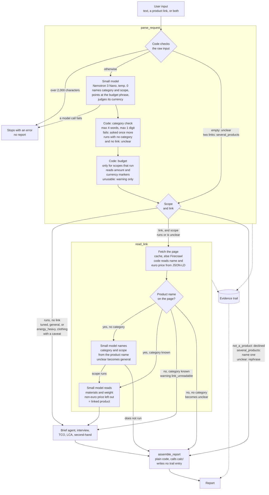
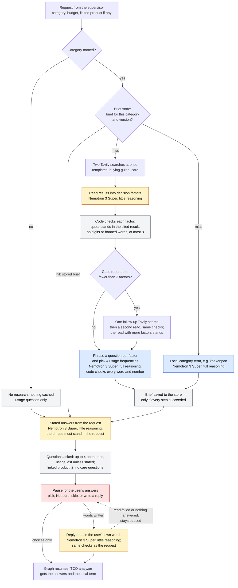
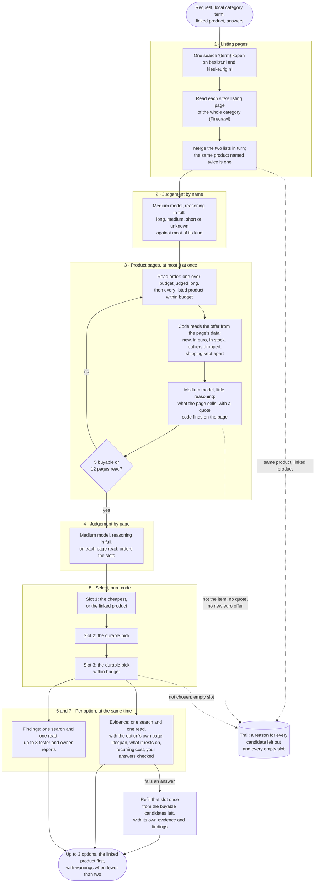
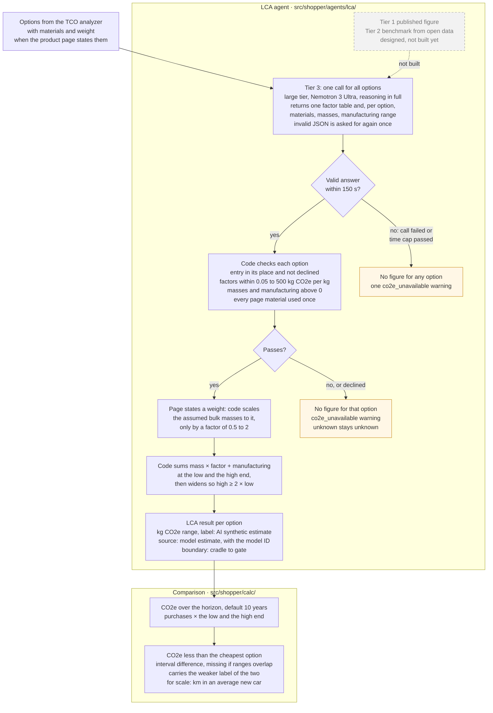

# Agent diagrams

Figures for people, one per agent that runs today, in the order the graph runs them; the README
links them. They add nothing to the docs that hold the rules (named under each heading), so no task
needs to read this file; when an agent's steps change, redraw its figure. How the agents connect is
in `agents.md` ("The graph") and `graph_diagram.md`. The second-hand agent is a stub and the
conversation agent is not built, so neither has a figure.

- [Supervisor](#supervisor-from-input-to-request)
- [Brief agent](#brief-agent-what-matters-and-the-questions)
- [TCO analyzer](#tco-analyzer-how-it-finds-product-options)
- [LCA agent](#lca-agent-the-co2e-to-make-each-option)

## Supervisor: from input to request

The supervisor turns what the user typed or pasted into a request: a product category, a scope
that decides whether the analysis runs and which caveat it carries, and a budget in euros. The
small model (Nemotron 3 Nano) only names the category and scope and points at the budget phrase;
code checks each, reads the amount, fetches a pasted link, and at the end assembles the report
with `calc/`. Code: `src/shopper/agents/supervisor/` and `src/shopper/agents/linked_product/`,
three nodes in `src/shopper/graph/graph.py`. Rules: `supervisor.md`.

## Brief agent: what matters and the questions

The brief agent finds out what matters when buying a product of the category, then asks the user
about it before any product is searched. The research runs once per category and is kept in the
brief store; each decision factor must quote a search result, and code checks the quote. The
questions come from those factors and end with how often the product will be used. Colours: blue
is a model call that reasons in full, amber one with little reasoning, grey plain code, red the
pause. Code: `src/shopper/agents/brief/` and `src/shopper/tools/brief_store.py`. Rules:
`category_brief.md`, `interview.md` and `reading_answers.md`.

## TCO analyzer: how it finds product options

The steps of option research as `src/shopper/agents/tco/` runs them (the rules are in
`option_research.md` and `option_evidence.md`). A dotted line
goes to the evidence trail.

## LCA agent: the CO2e to make each option

The LCA agent estimates the CO2e of making each option with one call to the large model (Nemotron
3 Ultra) for all of them. The model returns materials, masses, emission factors and a
manufacturing range, never a CO2e figure; code checks them, sums them into a range, and `calc/`
uses the range in the 10-year comparison (`docs/adr/0006-tier-3-returns-factors-code-multiplies.md`).
Code: `src/shopper/agents/lca/` and `src/shopper/calc/`. Rules: `lca.md` and `calculations.md`
("CO2e of a model estimate", "CO2e avoided").

