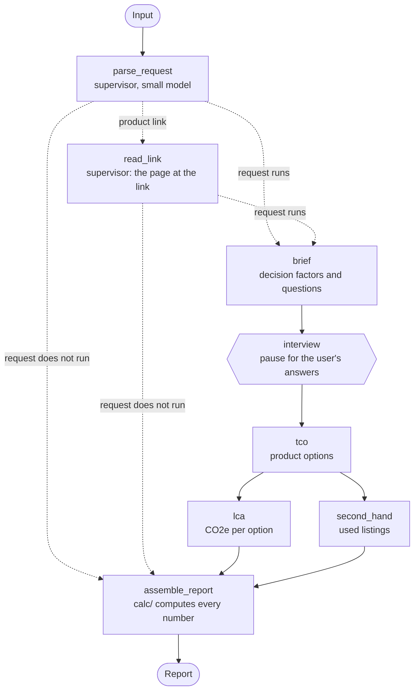

# Graph diagram

A figure for people. The graph is described in `agents.md` ("The graph"); this file adds nothing
to it, so no task needs to read it.

The nodes and edges as `build_graph` in `src/shopper/graph/graph.py` wires them. A dotted line is a
conditional edge. To print the diagram LangGraph derives from the code, for
comparison: `build_graph(chat, memory_checkpointer(), fixture_sources()).get_graph().draw_mermaid()`.

